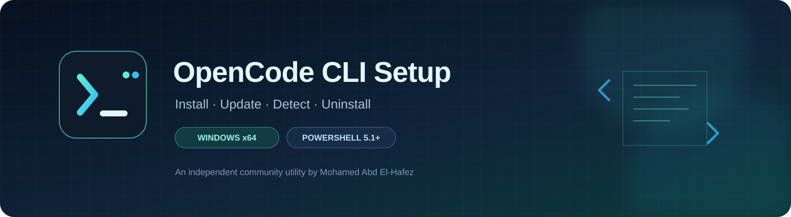

<div align="center">
  

  <h1>OpenCode CLI Setup</h1>
  <p><strong>A safer, straightforward Windows installer, updater, and uninstaller for OpenCode CLI.</strong></p>
  <p>
    
    
    
    
  </p>
  <p><em>Built by Mohamed Abd El-Hafez · Independent community utility · Not affiliated with OpenCode</em></p>
</div>

---

## Overview

**OpenCode CLI Setup** is a Windows utility for installing, updating, detecting, and uninstalling the OpenCode command-line interface from a terminal-based menu. It supports stable releases from the CLI 2 and CLI 1 release lines, validates downloads before replacing an existing executable, and can optionally add the selected installation folder to the current user's `PATH`.

> **Scope:** This project manages the OpenCode **CLI only**. It does not install, modify, or uninstall OpenCode Desktop.

## Features

- **Install and update** stable OpenCode CLI releases through a guided menu.
- **CLI 2 and CLI 1 support**, with versions presented as a selectable list.
- **CPU-aware CLI 2 package selection** for standard and baseline builds.
- **Download validation** using published integrity metadata when available, archive/path checks, executable checks, and version verification.
- **Rollback behavior** if a replacement operation fails.
- **Installation discovery**, including a deeper scan of fixed and removable drives when requested.
- **Careful uninstall behavior** that avoids deleting projects, settings, or OpenCode Desktop.
- **Optional user-level PATH integration**, after confirmation.
- **Offline logic tests** for key installer behaviors.

## Quick start

1. Download the latest ZIP from the repository's **Releases** page and extract it to a folder you control.
2. Keep `OpenCode-CLI-Setup.bat` and `OpenCode-CLI-Setup.ps1` together in the same folder.
3. Double-click `OpenCode-CLI-Setup.bat`.
4. Follow the interactive menu to install/update, uninstall, or scan for existing CLI installations.

For the best terminal colors, run it in Windows Terminal. Administrator rights are not normally required; a deep scan may skip protected folders unless elevated.

## Requirements

| Requirement | Details |
|---|---|
| Operating system | Windows x64; Windows ARM64 may run the x64 CLI through emulation but is not the target platform |
| PowerShell | Built-in Windows PowerShell 5.1 or newer |
| Network | HTTPS access to the official release sources for installation/update |
| Permissions | Standard user permissions for normal use; elevated permissions may be needed to inspect protected folders |
| Additional runtimes | No Python, Node.js, or npm installation is required to run this installer |

## Install or update

1. Open the launcher and choose **Install / Update** from the main menu.
2. Choose the default destination (`C:\Tools\OpenCode\CLI`) or enter a custom folder. The destination is created when needed.
3. Select a version from the available stable releases. Press Enter to accept the recommended release.
4. Review the confirmation screen and confirm the operation.
5. After a successful install, choose whether to add the folder to your **user PATH**. This is optional.

Beta, development, and pre-release versions are excluded from the selection list. CLI 1 and CLI 2 both use the `opencode` command; keep them in separate folders and ensure only the intended installation is on `PATH`.

### Official download sources

| Release line | Source and validation |
|---|---|
| CLI 2 | Official OpenCode CLI update endpoint and npm registry packages `@opencode/cli-windows-x64` / `@opencode/cli-windows-x64-baseline`; registry SHA-512 integrity is checked. |
| CLI 1 | GitHub releases from `anomalyco/opencode`, filtered for stable `v1.x.y` tags with the `opencode-windows-x64.zip` asset; SHA-256 is checked when published. |

The installer extracts only the expected executable and checks archive paths before extraction. If a replacement fails, it attempts to restore the previous executable. If no checksum is published for a package, validation relies on HTTPS and the remaining archive, PE, and version checks. **The executable's code signature is not checked.**

## Uninstall

1. Open the launcher and choose **Uninstall**.
2. Select the detected installation from the numbered list.
3. Review the target and confirm.

Only the selected CLI executable and installer-owned marker/temporary backup files are removed; the folder is removed only if it is left empty. Projects, settings, and OpenCode Desktop are not targeted. Installations managed by Scoop, Chocolatey, WinGet, or npm are refused and should be removed using their respective package manager.

## Find existing installations

At startup, the application checks the default destination, folders previously recorded by this installer, `PATH` entries, and selected common user locations. Use **Scan all drives** in the menu for a deeper search across fixed and removable drives. The scan uses the built-in `dir /s`; inaccessible folders may be skipped.

## Configuration

The main configuration is in section 1 (`$script:Cfg`) of `OpenCode-CLI-Setup.ps1`. Relevant settings include release endpoints, repository and asset names, release-list sizes, and trusted download hosts. Only change these settings if you understand the security and compatibility implications. Downloads are expected to use HTTPS from trusted hosts.

## Run the tests

The offline test suite is `Test-OpenCodeSetup.ps1` in the repository root. It stubs network responses and uses temporary test data; it is designed not to modify real installation locations or the registry.

Run from Windows PowerShell 5.1 or PowerShell 7:

```powershell
Set-ExecutionPolicy -Scope Process -ExecutionPolicy Bypass
.\Test-OpenCodeSetup.ps1
```

The execution-policy command affects only the current PowerShell process. The normal launcher likewise uses a process-scoped bypass and does not change the machine-wide policy.

## Repository layout

```text
OpenCode-CLI-Setup/
├── .github/                       # Issue and pull-request templates
├── assets/                        # Repository banner and project icon
├── OpenCode-CLI-Setup.bat         # Windows launcher
├── OpenCode-CLI-Setup.ps1         # Main application (kept at repository root)
├── Test-OpenCodeSetup.ps1         # Offline logic tests
├── LICENSE.txt                   # MIT license and attribution
├── CHANGELOG.md                  # Release history
├── CONTRIBUTING.md               # Contribution guidelines
├── SECURITY.md                   # Security reporting guidance
├── CODE_OF_CONDUCT.md            # Community standards
├── SUPPORT.md                    # Support and troubleshooting
├── .gitignore                    # Generated/local files to exclude
└── README.md                     # Project documentation
```

The launcher and application intentionally remain side-by-side because the launcher resolves its companion script relative to its own directory. The test script remains at the root because it loads the main script from its parent directory. **Do not move these three files without updating and re-testing their path assumptions.**

## Troubleshooting

- **The launcher says the companion script is missing:** restore `OpenCode-CLI-Setup.ps1` beside the `.bat` file; do not rename either file.
- **No releases are listed:** verify HTTPS connectivity. The CLI 1 source uses the GitHub API and can be affected by anonymous API rate limits; CLI 2 may still be available.
- **A folder is skipped during a drive scan:** the current user may not have permission to read it. Elevation can reveal more folders but should be used only when necessary.
- **The `opencode` command resolves to the wrong version:** inspect `PATH` order and separate CLI 1/CLI 2 installations.
- **A package is rejected:** do not bypass validation manually. Check the release source and report reproducible details using the issue template.

## Security and privacy

The installer downloads software from configured official sources and performs validation before installation. No installer can eliminate all supply-chain risk. Review the code before running it, keep Windows and PowerShell updated, and report suspected vulnerabilities privately according to [SECURITY.md](SECURITY.md). Never post tokens, private URLs, or personal data in public issues.

## Project ownership and third-party trademarks

Copyright © 2026 **Mohamed Abd El-Hafez**. All rights reserved, subject to the terms in [`LICENSE.txt`](LICENSE.txt). The project is an independent community utility and is not affiliated with, endorsed by, or sponsored by OpenCode or its maintainers. OpenCode names and software remain the property of their respective owners.

## License

This project is distributed under the [MIT License](LICENSE.txt). The license and attribution notice must be retained with copies or substantial portions of the software.

---

<div align="center">
  <sub>Designed for clarity, cautious installation, and a dependable Windows CLI workflow.</sub>
</div>
